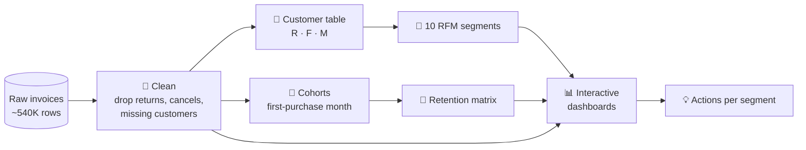

<div align="center">


[](https://github.com/YOUR-USERNAME/ecommerce-customer-analytics)


### 🚀 Try the live dashboards

[](https://YOUR-USERNAME.github.io/ecommerce-customer-analytics/ecommerce_bi_dashboard.html)
[](https://YOUR-USERNAME.github.io/ecommerce-customer-analytics/rfm_analysis_interactive.html)
[](https://YOUR-USERNAME.github.io/ecommerce-customer-analytics/cohort_analysis_interactive.html)
[](https://YOUR-USERNAME.github.io/ecommerce-customer-analytics/ecommerce_results.html)

</div>

<!-- Add a dashboard GIF here: -->
<!-- <p align="center"></p> -->

---

## 🧭 Choose your path

| I want to… | Jump to |
|---|---|
| Understand the idea in 30 seconds | [The pitch](#-the-pitch) |
| See how the analysis works | [The pipeline](#-the-pipeline) |
| Meet the customer segments | [Meet your customers](#-meet-your-customers) |
| Run it myself | [Run it](#-run-it) |
| See what I learned | [Findings](#-findings) |

---

## 🎯 The pitch

Every online store has two kinds of customers: the ones who quietly keep the business alive, and the ones about to disappear. Raw transaction logs don't tell you which is which.

This project turns **~540K raw invoice lines** into answers:

- 👑 **Who** are the best customers, and how much of the revenue do they carry?
- 😴 **Who** is drifting away, and is there still time to win them back?
- 🔁 **How long** do new customers stick around after their first purchase?
- 📅 **When** and **where** does the money come in?

> 💡 **Scope note:** churn *risk* is identified through RFM segments and cohort retention. No predictive churn model is trained.

---

## 🔬 The pipeline



<details>
<summary><b>🧹 Step 1 — Cleaning (click to expand)</b></summary>

<br>

| Problem in raw data | Fix |
|---|---|
| Missing `CustomerID` | Dropped (can't be tracked) |
| Cancelled invoices (`C…`) | Removed |
| Returns / negative quantities | Removed |
| Zero or negative prices | Removed |
| `CustomerID` stored as text (`12349.0`) | Converted to integers |

Without this, negative revenue distorts totals, RFM scores and retention rates.

</details>

<details>
<summary><b>🧩 Step 2 — RFM scoring (click to expand)</b></summary>

<br>

- **R**ecency: days since last purchase (lower is better)
- **F**requency: number of unique invoices
- **M**onetary: total spend

Each metric gets a 1–5 score using **rank-based quintiles**, so heavily tied values (like "1 order") don't break the bins. Recency and Frequency scores then map to a segment.

</details>

<details>
<summary><b>🔁 Step 3 — Cohort retention (click to expand)</b></summary>

<br>

1. Assign every customer to the month of their first purchase.
2. Count how many months later each purchase happens (exact month difference).
3. Retention = customers active in month *n* ÷ customers in the cohort.

The result is a cohort × month matrix, explored as a heatmap you can switch between **% retained** and **customer counts**.

</details>

---

## 🧑‍🤝‍🧑 Meet your customers

Ten personas, one per RFM segment. Expand a card to see who they are and what to do about them.

<details>
<summary>👑 <b>Champions</b> — recent, frequent, loyal</summary>

**Behaviour:** bought recently and buy often.
**Play:** reward them, ask for reviews, give early access. Protect this group first.

</details>

<details>
<summary>💛 <b>Loyal Customers</b> — steady, dependable</summary>

**Behaviour:** regular orders, solid spend.
**Play:** upsell higher-value products and keep them satisfied.

</details>

<details>
<summary>🌱 <b>Potential Loyalists</b> — recent, still building a habit</summary>

**Behaviour:** recent buyers with a couple of orders.
**Play:** offer membership or loyalty programs to lock in the habit.

</details>

<details>
<summary>🆕 <b>New Customers</b> — just arrived</summary>

**Behaviour:** very recent first purchase.
**Play:** onboarding support and a welcome offer. This is where cohorts lose the most people.

</details>

<details>
<summary>✨ <b>Promising</b> — recent but one-off</summary>

**Behaviour:** recent, low frequency.
**Play:** build brand awareness and offer a reason to come back.

</details>

<details>
<summary>⚠️ <b>Need Attention</b> — good history, going quiet</summary>

**Behaviour:** decent frequency but not so recent.
**Play:** limited-time offers and personalised recommendations.

</details>

<details>
<summary>😴 <b>About to Sleep</b> — fading</summary>

**Behaviour:** low recency and low frequency.
**Play:** share useful content and recommend products before they lapse.

</details>

<details>
<summary>🚨 <b>At Risk</b> — used to buy, now gone quiet</summary>

**Behaviour:** moderate past frequency, not recent.
**Play:** personalised emails and discounts.

</details>

<details>
<summary>💔 <b>Cannot Lose Them</b> — big past buyers, now silent</summary>

**Behaviour:** very high past frequency, long absence.
**Play:** win them back through renewals or newer products. Highest-value rescue target.

</details>

<details>
<summary>🧊 <b>Hibernating</b> — long gone</summary>

**Behaviour:** low frequency, long absence.
**Play:** low-cost reactivation offers; don't over-invest.

</details>

---

## 📊 What's in the dashboards

<table>
<tr>
<td width="50%" valign="top">

### 📊 BI Dashboard
Country, monthly trend, top products, customer segments, price bands and a weekday × hour heatmap. Every panel has a dropdown to switch the metric.

</td>
<td width="50%" valign="top">

### 🧩 RFM Dashboard
Every customer as a dot, colored by segment. Filter by segment, switch the bar metric, and hover any cell of the Recency × Frequency grid.

</td>
</tr>
<tr>
<td width="50%" valign="top">

### 🔁 Cohort Dashboard
Retention heatmap with a % / count toggle, per-cohort retention curves, and cohort sizes.

</td>
<td width="50%" valign="top">

### 🎯 Results Dashboard
Headline KPIs, insight cards generated straight from the data, and switchable revenue views.

</td>
</tr>
</table>

---

## 🏃 Run it

<details>
<summary><b>Quick start (click to expand)</b></summary>

<br>

```bash
git clone https://github.com/francis23456776/E-Commerce-Insights_-RFM-Customer-Churn-Analytics.git


python -m venv venv
source venv/bin/activate        # Windows: venv\Scripts\activate
pip install -r requirements.txt

jupyter notebook E-commerce_churn_analysis.ipynb
```

1. Place the dataset CSV in `data/` and update the path in the notebook.
2. Run the cells that load and clean the data (the result is stored in `df`).
3. Run any `interactive_*.py` file as a notebook cell.
4. Open the saved `.html` files in a browser.

</details>

<details>
<summary><b>Repository layout (click to expand)</b></summary>

<br>

```
.
├── E-commerce_churn_analysis.ipynb
├── interactive_results_dashboard.py
├── interactive_ecommerce_bi_dashboard.py
├── interactive_rfm_analysis.py
├── interactive_cohort_analysis.py
├── requirements.txt
└── data/                 # dataset goes here (not tracked)
```

</details>

---

## 🔎 Findings

<!-- Run the notebook, then replace these with your real numbers. -->

| Metric | Result |
|---|---|
| 💷 Revenue from top market | _X%_ (_country_) |
| 👑 Champions share of customers → revenue | _X%_ → _X%_ |
| 🔁 Month-1 → Month-6 retention | _X%_ → _X%_ |
| 📅 Peak revenue month | _month_ |

### What I'd do next if this were a real store

- Protect **Champions** and **Loyal Customers** first; they carry the most revenue.
- Launch a win-back campaign for **At Risk** and **Cannot Lose Them** customers.
- Fix the **first 1–3 months** after purchase, where cohorts lose the most customers.
- Schedule promotions ahead of the seasonal peak.

---


**Built by [Antony Jeba Francis]** · [LinkedIn](https://www.linkedin.com/in/antony-jeba-francis-s-720821256) · [GitHub](https://github.com/francis23456776)

⭐ If this helped you, a star is appreciated!


</div>
